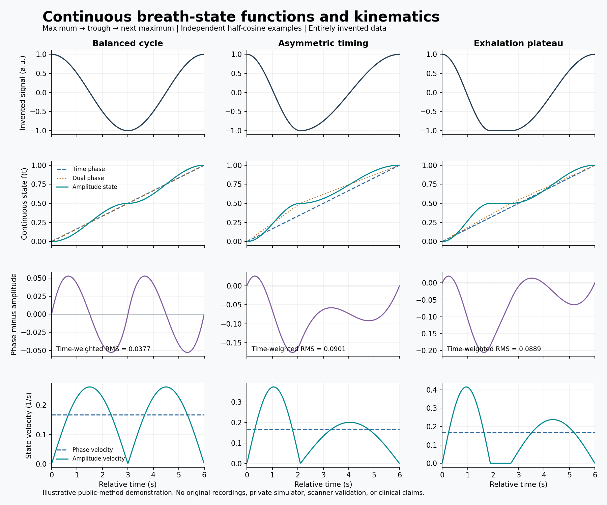

# Breath State Waveform

A scientific-computing portfolio with an offline **Breath State Laboratory**,
continuous state-comparison methods and a limited Python VXP-processing toolkit.
The browser laboratory generates entirely invented respiratory waveforms;
the Python tools demonstrate strict parsing, relative timing, amplitude scaling,
quality-aware smoothing and window statistics. The two runtimes are independent:
the browser app has no package dependencies, and the Python tools use the standard
library except for optional plotting.

Maintained by [Jorge Barbosa Pereira](https://github.com/jorge-barb-pereira).
This independent edition uses entirely invented examples and makes no clinical
validation or equipment-compatibility claim.

## Ten-bin sorting study results

The [complete results table](docs/SORTING_RESULTS.md) contains **20 synthetic
comparisons on 12 constructed cycles**, with continuous circular RMSD, maximum
distance, exact ten-bin mismatch, occupancy and time in each bin-width regime.
The [formal definitions](docs/SORTING_METHODS.md) distinguish pointwise shading
from the user-defined whole-cycle RMSD classification.

| Continuous state analysis | Discrete ten-bin analysis |
| --- | --- |
| [Canonical cycles](docs/figures/sorting-continuous.svg) | [Canonical cycles](docs/figures/sorting-discrete.svg) |
| [Constructed limiting families](docs/figures/extremes-continuous.svg) | [Constructed limiting families](docs/figures/extremes-discrete.svg) |

Linear asymmetric branches agree exactly under dual-phase normalization, but
half-cosine branches retain an RMSD of approximately 0.037719. The latter
receives the descriptive label “Similar Processing” while about 34.76% of
sample times still have different centred-bin identities. Continuous proximity
and exact bin agreement answer different questions. These are numerical
results on invented signals, not clinical or image-quality evidence.

The [machine-readable report](docs/results/sorting-study.json) records the
sample grid, bin convention, method and all per-case values. To regenerate it:

```sh
python tools/generate_sorting_study.py
# Optional, with NumPy and Matplotlib installed:
python tools/generate_sorting_study.py --plot
```

Generated files stay under ignored `output/sorting-study/`; only reviewed
synthetic results and independently written documentation are included here.

## Interactive Breath State Laboratory

Open `laboratory/index.html` in a modern browser. Alternatively, serve only that
directory locally:

```sh
python -m http.server 8080 --bind 127.0.0.1 --directory laboratory
```

Open `http://127.0.0.1:8080/`. Adjust cycle timing, expiration share, excursion,
bin count and an end-expiratory pause. Compare uniform phase, branch-balanced
phase and amplitude state, then inspect circular disagreement and time-in-bin
occupancy. CSV export contains generated synthetic samples only.

This independently written laboratory has no recording import, external calls,
telemetry or persistent browser storage. It is an educational demonstration,
not a reproduction of a private application or a clinical acquisition tool.
See [laboratory equations](docs/LABORATORY_METHODS.md),
[verification](docs/LABORATORY_VALIDATION.md) and
[release scope](docs/LABORATORY_PUBLICATION.md).

**Metric conventions differ deliberately.** The Python research module integrates
the signed linear phase-minus-amplitude difference on a selected cycle. The
browser laboratory reports sampled circular distances on periodic synthetic
cycles. Their RMS values and maxima are not interchangeable; the documentation
states each sampling, boundary and integration convention explicitly.

## What this release demonstrates

- A bounded VXP 1.6 reader that follows declared column order and rejects
  malformed, non-finite, duplicate-time, and unsupported inputs.
- Relative seconds and scaled amplitudes, without returning identifying headers.
- Explicit invalid-sample handling and smoothing that does not bridge timing gaps.
- Time-window statistics with valid/total counts and partial-window visibility.
- Continuous cycle functions, state velocities, time-weighted RMS/L2 comparisons,
  and explicit bin-disagreement histograms.
- Deterministic invented fixtures, reproducible CLI examples and analytic checks.
- An offline interactive browser laboratory with numerical and release tests.
- A centred circular ten-bin study with continuous and discrete figure plates,
  explicit classifications and a reproducible machine-readable report.
- An explicit publication allowlist and documented limitations.

The research module uses independently defined maximum/trough/next-maximum
cycles and general time/amplitude normalization. It does not reproduce a private
simulator or claim complete parity with another research implementation.
See [research definitions](docs/RESEARCH_METHODS.md) and
[publication scope](docs/PUBLICATION_SCOPE.md).



## Run

Requires Python 3.10 or newer. No installation or network access is needed.

```sh
python -m signal_demo
python -m signal_demo --vxp-demo
python -m signal_demo --vxp examples/synthetic.vxp
python -m signal_demo.research --output output/research
python -m unittest discover -s tests -v
python tools/check_release.py
```

Run these commands from a Git checkout. No account, network connection, package
installation, hardware, or original recording is required. The optional local
reader is demonstrated with the included invented fixture, not clinical data.

To regenerate the optional figure, install Matplotlib from its official package
distribution, then run `python -m signal_demo.research --output output/research --plot`.
The numeric research report and test suite require no plotting dependency.

The command generates twelve seconds of invented samples in memory, prints an
ASCII waveform, and reports one-second windows as `quiet`, `oscillating`, or
`varying`. See [the example output](examples/demo-output.txt). The VXP commands
use invented VXP content and report numeric features without clinical labels.
See [VXP processing methods](docs/vxp-processing.md) and
[the VXP example output](examples/vxp-output.txt).

## Design

- A seeded local random generator makes the example reproducible.
- Three invented four-second segments illustrate different waveform shapes.
- A centered three-sample moving average illustrates smoothing.
- Window features use the original synthetic samples: population standard
  deviation and mean absolute difference between adjacent samples.
- Arbitrary educational cutoffs assign descriptive labels: standard deviation
  below 0.1 means `quiet`; otherwise mean adjacent difference above 0.3 means
  `varying`; remaining windows are `oscillating`.
- The ASCII trace displays the smoothed waveform. Features use unsmoothed data
  so smoothing does not conceal the deliberately introduced variation.

Sample rate, shapes, durations, noise, and cutoffs are invented teaching choices.
They are not fitted to measurements or intended to represent a real population,
device, facility, or operating environment. The states have no physiological or
diagnostic meaning. This project makes no clinical validation claim.

## Repository map

| Path | Purpose |
| --- | --- |
| `laboratory/` | Offline synthetic respiratory-waveform and state explorer |
| `signal_demo/core.py` | Invented signal generator, smoothing, features and descriptive labels |
| `signal_demo/vxp.py` | Bounded VXP subset reader and quality-aware numeric processing |
| `signal_demo/__main__.py` | Offline demos and explicitly selected local-file CLI |
| `signal_demo/research.py` | Continuous cycle functions, derivatives, RMS/L2 and bin comparisons |
| `signal_demo/sorting.py` | Centred circular bins, synthetic families, exact/numerical sorting scores |
| `tools/generate_sorting_study.py` | Reproducible study report and optional synthetic figure plates |
| `examples/` | Invented VXP fixture and reviewed command output |
| `tests/` | Numerical checks, malformed-input rejection and CLI regressions |
| `tests/browser/` | Browser-model mathematics and offline release checks |
| `docs/` | Format reference, scope, validation and limitations |
| `tools/check_release.py` | Explicit public-file boundary check |
| `tools/check_laboratory.cjs` | Text patterns, allowlist and local Git-path/history checks |

Browser checks require Node.js 22 or newer, with no dependency installation:

```sh
npm test
npm run check:release
```

GitHub Actions is configured to run the Python and browser checks in separate
jobs. It uses invented inputs only and uploads no generated artifacts. Local
verification is recorded separately from any future online CI result.

Read the [VXP method reference](docs/vxp-processing.md),
[validation record](docs/VALIDATION.md), and
[contributing guide](CONTRIBUTING.md) for interpretation and maintenance details.

## Scope and provenance

This implementation was written independently for this demonstration. It uses
general arithmetic and Python's standard library. The limited VXP reader is
based on a publicly accessible manufacturer format description, attributed in
the VXP documentation. No professional project code,
records, trained models, configurations, images, or outputs were transferred.
There are no external datasets or third-party code dependencies to redistribute.

The default CLI uses invented samples only. The optional `--vxp LOCAL_FILE`
command reads one explicitly selected local text file and prints a numeric
summary. Metadata removal does not anonymize numeric traces or their summaries.
Use only separately approved inputs. No trained models, network or database
integrations are present. The signal/VXP CLI paths print summaries; the research
CLI writes invented numeric results and optional plots under ignored `output/`.
The browser can download generated synthetic samples only.

The dimensionless demo rejects incomplete final analysis windows. VXP windows
use timestamps and retain partial windows with counts, excluding invalid rows
from statistics. Non-finite input values are rejected in both paths.

## Release discipline

`PUBLICATION_ALLOWLIST.txt` lists the exact public files, including the invented
VXP fixture. Other VXP recordings are ignored by default. The release check
rejects additional non-ignored files, symlinks, and mismatches between the
allowlist and Git's tracked files. It does not prove confidentiality or inspect
historical commits, staged blob contents, packages, or remote artifacts.

Python bytecode caches and common local configuration files are ignored. The
synthetic-only CI workflow includes no artifact-upload or publishing step. No
package-build or external runtime integration is configured. Review every file,
the staged diff, and the intended commit before
publication; an allowlist and text checks do not establish redistribution rights
or guarantee confidentiality. Any changed release requires a new review.

The included PNG is generated from the built-in invented research examples.
The SVG figure plates are independently generated from the synthetic sorting
fixtures. Their content and metadata require review in addition to file checks.
The browser release checker also verifies that locally tracked and historical
paths are allowlisted; this does not inspect every historical file's content or
prove confidentiality. The Python release checker validates the existing PNG
metadata, checks SVG structure and regenerates both synthetic numeric reports
for comparison.

## License

The independently written demonstration is available under the MIT License.
