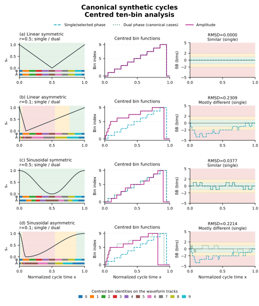
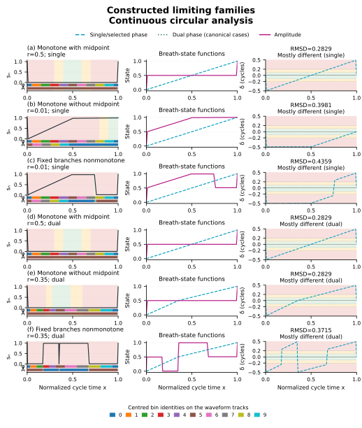
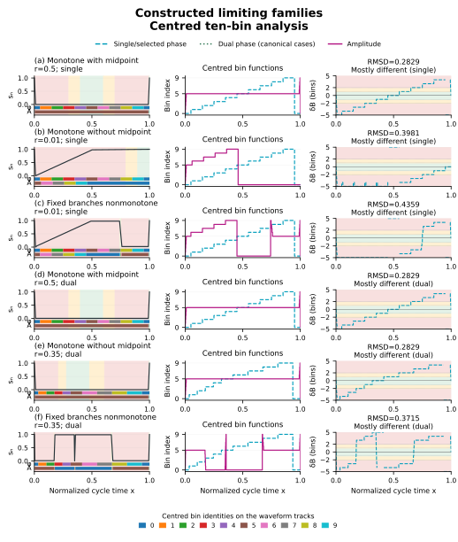

# Synthetic ten-bin sorting results

All signals are independently constructed. These are empirical numerical descriptions of mathematical examples, not clinical observations or image-quality validation.

## Protocol

Ten centred circular bins use `B(f) = floor(10*(f mod 1)+1/2) mod 10`. The signed difference is phase minus amplitude, wrapped to half a cycle. Antipodal ties retain their unwrapped sign. Each result uses 20,000 uniformly spaced midpoint samples over a complete normalized cycle. All examples have full valid coverage.

Continuous pointwise regimes are distance ≤1 BW, >1 to ≤2 BW, and >2 BW, with BW=0.1. The separate user-defined RMSD labels use ≤0.5 BW, >0.5 to ≤1.5 BW, and >1.5 BW. Neither scheme guarantees exact bin agreement. Exact centred-bin mismatch is scored independently.

## Complete result table

| Synthetic case | Phase | Maximum D | RMSD | RMSD / BW | Different bins | ≤1 BW | 1–2 BW | >2 BW | RMSD label |
| --- | --- | ---: | ---: | ---: | ---: | ---: | ---: | ---: | --- |
| linear_symmetric | single | 0.000000 | 0.000000 | 0.000 | 0.00% | 100.00% | 0.00% | 0.00% | Similar Processing |
| linear_symmetric | dual | 0.000000 | 0.000000 | 0.000 | 0.00% | 100.00% | 0.00% | 0.00% | Similar Processing |
| linear_asymmetric | single | 0.400000 | 0.230940 | 2.309 | 88.00% | 25.00% | 25.00% | 50.00% | Mostly different processes |
| linear_asymmetric | dual | 0.000000 | 0.000000 | 0.000 | 0.00% | 100.00% | 0.00% | 0.00% | Similar Processing |
| sine_symmetric | single | 0.052628 | 0.037719 | 0.377 | 34.76% | 100.00% | 0.00% | 0.00% | Similar Processing |
| sine_symmetric | dual | 0.052628 | 0.037719 | 0.377 | 34.76% | 100.00% | 0.00% | 0.00% | Similar Processing |
| sine_asymmetric | single | 0.402029 | 0.221359 | 2.214 | 92.95% | 15.72% | 34.27% | 50.00% | Mostly different processes |
| sine_asymmetric | dual | 0.052628 | 0.037719 | 0.377 | 34.77% | 100.00% | 0.00% | 0.00% | Similar Processing |
| extreme_midpoint | single | 0.490000 | 0.282902 | 2.829 | 89.80% | 20.41% | 20.41% | 59.18% | Mostly different processes |
| extreme_midpoint | dual | 0.490000 | 0.282902 | 2.829 | 89.80% | 20.41% | 20.41% | 59.18% | Mostly different processes |
| extreme_monotone_single | single | 0.490000 | 0.398078 | 3.981 | 94.90% | 10.41% | 10.41% | 79.18% | Mostly different processes |
| extreme_nonmonotone_single | single | 0.500000 | 0.435946 | 4.359 | 99.80% | 1.21% | 1.21% | 97.58% | Mostly different processes |
| extreme_monotone_dual | dual | 0.492308 | 0.282907 | 2.829 | 89.80% | 20.41% | 20.41% | 59.19% | Mostly different processes |
| extreme_nonmonotone_dual | dual | 0.490000 | 0.371550 | 3.715 | 99.80% | 1.21% | 1.21% | 97.58% | Mostly different processes |
| dashboard_default | single | 0.175261 | 0.076916 | 0.769 | 47.29% | 79.53% | 20.47% | 0.00% | Some possible differences |
| dashboard_default | dual | 0.112586 | 0.056993 | 0.570 | 46.39% | 87.72% | 12.28% | 0.00% | Some possible differences |
| dashboard_pause | single | 0.175261 | 0.080904 | 0.809 | 55.23% | 79.53% | 20.47% | 0.00% | Some possible differences |
| dashboard_pause | dual | 0.175261 | 0.085135 | 0.851 | 53.45% | 73.39% | 26.61% | 0.00% | Some possible differences |
| dashboard_asymmetric | single | 0.218470 | 0.115400 | 1.154 | 83.58% | 50.00% | 42.30% | 7.70% | Some possible differences |
| dashboard_asymmetric | dual | 0.052628 | 0.037719 | 0.377 | 34.77% | 100.00% | 0.00% | 0.00% | Similar Processing |

## Continuous and discrete figures

The narrow coloured tracks below each waveform identify centred single/selected-phase and amplitude bins. In the canonical plates, waveform time shading and the RMSD label refer to single phase; both single- and dual-phase curves are plotted in the comparison panels. Each limiting-family row instead uses its explicitly selected phase method. Difference-panel shading is in continuous bin-width units or integer bin units, as labelled. Colours do not encode clinical severity.

The four figure plates show the eight canonical and six limiting-family comparisons. The six dashboard-parameter comparisons are included in the complete table and machine-readable report; they are not additional rows in those plates.

## Interpretation and limits

The linear symmetric example agrees exactly. A linear asymmetric cycle has nonzero single-phase disagreement but exact dual-phase agreement. Half-cosine branches retain within-branch nonlinear disagreement even after dual-phase normalization. A low RMSD label can coexist with nonzero bin mismatch because very close coordinates can straddle a threshold.

Constructed extreme examples use epsilon=0.01. Their two phase comparisons can use different waveforms or selected minima; they are not a controlled same-waveform superiority experiment. Reported limiting values apply to the stated constructed families. A numerical example does not prove global sharpness over every possible admissible waveform.

Piecewise-linear RMSD is integrated analytically with splits at circular wrap boundaries. Smooth RMSD and duration/bin fractions use midpoint quadrature; maxima use explicit joins and analytic stationary points. A denser-grid sensitivity is checked in tests. Percentages are numerical approximations, with no population or sampling-confidence interpretation.

[Formal definitions](SORTING_METHODS.md) · [Machine-readable results](results/sorting-study.json) · [Reproduction](VALIDATION.md).
